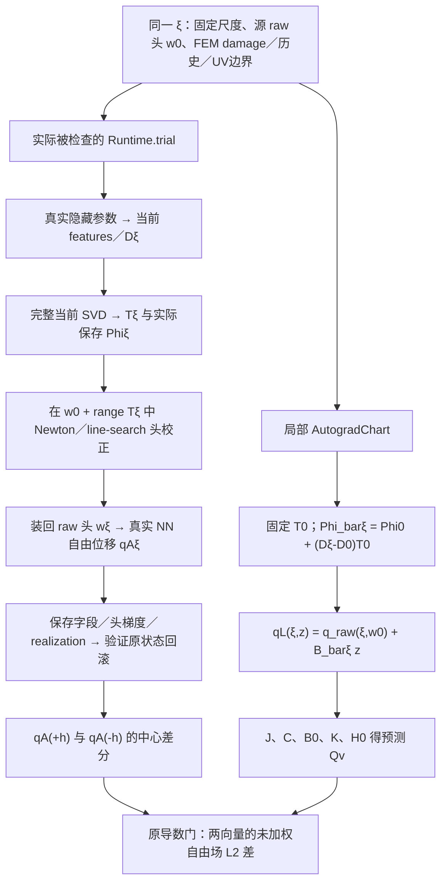

# 冻结c20：实际profile与局部导数的离线归因／记录修复

目的：最终仍是让PIDL复现已收敛FEM的场和平衡；当前先确认优化使用的导数是否属于实际被求解的函数。承接[真实R2首检失败](../runs/pidl_profiled_hidden_hq_r2_result_20261020.md)，不把记录完整性当方法改善。

本轮范围：HQ在已核实的人方夜间托管授权内，明确批准同一owner的离线机制归因、异常安全记录修复与聚焦复核。**不是原R2自动重试。** 未SSH、未新读holdout、未读真实权重／Phi／原始场做重放、未新NN/JVP/VJP/SVD/FEM／扰动／物理求解，未占GPU。只读既有紧凑元数据、字段分析结果和源码；实现验证仅新人工小夹具与异常注入，不重跑42旧测试／全包数学审查。

结论：存在两个仍需区分的解释：①实际复合映射与局部锚定chart对应不完全相同；②有限h近似、有限精度和非精确头闭合经病态坐标变换及差分放大。已有证据无法选定唯一根因。本轮只把下一次诊断需要的原量与失败路径补齐，R2科学结论、1e-10及全部已消费授权不变。

## 同一个“profile”实际有哪两种映射

固定物理状态：FEM c20第4加载子步峰值、同一damage和历史、原UV边界及B0。节点86756，自由位移DOF172916；raw UV头每分量401列，保留rank386，联合头坐标772。自由场向量先拼接全部u、全部v，再按原free索引选取；导数门使用**未加权Euclidean L2**，不是mass误差／H1／active加权relL2。

记隐藏局部坐标为ξ，真实参数为θ(ξ)=θ₀+s⊙ξ，s是已冻结的逐参数尺度；w₀为源端点raw UV头。D(ξ)=U·bubble·[features(θ(ξ)),1]，原UV位移为q_raw(ξ,w)=lift+D(ξ)w（两分量独立、最后限制到自由DOF）。代码保留原fieldCalculation运算次序，以下只写数学等价式。

### 局部图的导数是什么

`E011Bridge.moving_phi`复用已存实际Phi₀，并固定T₀，只对(D(ξ)−D₀)求导。B是其两位移分量的block映射。源z=0处：

- R=∂E/∂q，K=∂R/∂q；J=∂q_raw/∂ξ，H=BᵀKB。
- C v=(∂Bᵀ/∂ξ·v)R；实现中的R在这个混合项里detach。**C已经实现，不能写成“漏了C”。**
- Uv=BᵀKJv+Cv；预测 Qv=Jv−BH⁻¹Uv。

这是对**所定义的局部锚定族**头驻点方程BᵀR=0的隐函数导数。它假设当前z=0是头驻点；实际仅在原1e-10阈值内闭合，不是数学上精确为0。J包含源raw头w₀的所有已存系数，不能再次把B′z加入z=0的J。局部伴随检查和H=BᵀKB只核同一个图内部自洽，不核实际profile映射。

### 实际有限差分的映射是什么

`Runtime.trial`每次从同一源状态出发：θ(±hv)→重新生成完整当前条件基(T±,Phi±)→以当前raw头w₀为起点求z±→装入w±=w₀+T±z±→真实网络回放qA(±hv)。被舍弃的raw系数不是清零，而是保留在w₀中。实际Phi、实际头梯度、realization误差及回滚均有原生记录。

固定T₀的局部图不含当前SVD变换的导数D₀·T′。但**不能仅凭T变化就断言缺项造成失配**：若变化只是同一保留物理子空间内可逆换基，且头精确求解，纯坐标旋转本应抵消。真正需要辨别的是保留子空间随ξ的变化、锚定Phi₀与浮点D₀T₀的差，以及非精确驻点／数值放大。rank相同不等于这些量不变。

源端点三次读数用的是**同一保存Phi₀**。它们不构成“fresh SVD后重新求头的qA(0)=q₀”证明；R2没有单独执行该fresh-zero映射。也没有h/2和第二实际方向结果。

## 两个竞争解释与可判别签名

|解释|既有证据支持／排除到哪里|应出现的判别签名|目前缺什么|
|---|---|---|---|
|H1：导数目标不完全相同，实际移动保留族不同于局部锚定族|局部图自洽而实际profile FD门失败，与H1相容；rank386只排除已观察到的离散rank跳变。不能排除纯数值效应，也不能把任意换基当物理子空间变化。|以同样ξ和原h分别有限差分局部chart自身与原实际映射：chart FD能对上Qv，实际FD稳定但对不上；两个h下差异持续且重复波动不足以解释。|当时Qv／FD／error／scale未落盘；actual fresh-zero、chart自身的头校正FD、当前保留族变化对物理场的影响。|
|H2：有限h／有限精度／近似头闭合影响导数估计|原特征条件数约5.25e8、T maxabs约7.37e7；源zero-trace=0不保证±h不跨Amor分支；两侧实际头g∞虽均≤1e-10，仍非精确驻点。realization≤3.63e-13是场实现误差，不是profile导数误差界。源复用读数完全一致仅排除该源读取路径的可见漂移。|重复同一±h的场或头变化产生的FD波动与失配同量级，或较小h使误差明显按数值扰动/h放大；chart控制也可能受影响。若纯确定性浮点偏差或有限h跨分支，重复完全一致仍不能排除H2。|失败时预测向量及差；相同±h重复、h/2响应、已有计算中的trace分支标签与头求解残差/条件/坐标量，缺少能把头闭合误差传播到字段差分的有效界。|

保存±场的odd/even比7.5403e-4只描述一个h下的响应，**不是导数失配比例，也不是噪声估计**。本轮不把H1或H2升级为已证实原因；二者可以同时存在。

## 观测实现的最小改变

新增`profiled_hidden_receipts.py`，`reprofile_check`接入可选记录回调，真实`Runtime.verify_profile`强制启用。数学表达式、h=1e-6及h/2、两方向顺序、rank规则、头g∞／realization1e-10、导数abs1e-10+rel1e-4和范数不变。

事件按以下顺序独占提交：

1. context／source_order：当前源网络identity及编码、captured raw UV头、基底建立时权重SHA（单独命名，避免冒充当前头）、Phi/T/hidden绑定、原free DOF顺序、q₀和带s/H/R的既有local-point引用。
2. direction：v原量；prediction：Qv原量。先落盘，再做±回放。
3. side_start：符号、h、实际delta；side_returned：原始q±、E/Ru、rank、头梯度、真实readout／actual投影梯度／solver／head坐标／基底／权重／回滚文件的SHA引用。raw数组在合同检查前保存；不合格亦留存。
4. comparison：FD、Qv−FD、各范数、error、scale、实际tol，全部落盘后才执行同一原判据。
5. check_failed／check_passed：失败位置和原异常。callback中途失败也保存已完成一侧、delta与独立回滚证明；失败摘要绑定该trial已有的原生字段／solver／权重文件，缺项明确available=false。

NPY和JSON先flush/fsync，再以不覆盖的原子hard-link发布，JSON事件最后提交；已有目录／文件／旧temp不会覆盖。JSON使用原`*.json.<PID>.tmp`，NPY用精确受控`.profile_audit_npy.<PID>.tmp`；storage sampler只新增对该精确消失临时名的容忍。存在temp仍计数，其他payload消失、任意NPY temp、权限／symlink错误继续停止。避免重新引入R1的walk→stat竞态。

记录IO失败在尚无科学异常时停止，不继续新回放；如果已有科学／回滚异常，附加记录错误，不用次要日志错误覆盖原异常。该实现只能使后续诊断可解释，不能恢复旧R2未保存的Qv。

## 验证及边界

新增人工小夹具覆盖：原通过行与callback/h顺序完全相同；首对失配前Qv／±q／FD／difference／error／scale／tol可读可核SHA；不合格和非有限原量保留；minus异常不丢plus；写盘失败不多跑callback且不覆盖主异常；独占目录；中途callback失败回滚证明；原生失败日志写错不覆盖主异常；真实writer temp被walk捕获、commit后stat的确定性集成竞态；现存temp／缺payload／权限／symlink策略。

只跑新`test_profiled_hidden_receipts.py`，最终14项通过。命令为`PYTHONDONTWRITEBYTECODE=1 PYTHONPATH=tools/s04_e011_analysis /Users/wenxiaofang/miniconda3/bin/python3 -B -m pytest -q tools/s04_e011_analysis/test_profiled_hidden_receipts.py`（测试自身加入storage sampler兄弟目录）；其中scalar torch只作回滚状态簿记，没有Module、forward、AD或物理求解。旧数学测试及既有R2数值结论直接复用。聚焦记录差量独立复核见`review.json`；本轮记录准备完成不等于真实producer可用或新比较完成。新receipt模块及storage sampler差量尚未部署；旧R2封装／源绑定保持不可变，不能直接拿旧封装运行这些新文件。若HQ选择后续数值动作，须在其同一授权内按新源commit纳入这些文件并重新封装，不再把机械打包拆成新的科学审批。

## 一项后续机制比较设计（未执行，交HQ科学／排程决策）

**问题：** Qv确实是局部chart的正确导数，但目标函数族与真实profile不同，还是有限h／有限精度／头近似闭合足以解释失配？直接做一次有两个明确定义映射的完整机制比较，不再默认重跑3000秒优化全链。

复用现有冻结c20源、所有原始输入／原UV／FEMd／Phi₀、方向seed173与参数尺度。先只从已核验R2归档按原manifest取回必要的T±、头z／gradient／solver和local point引用，用于坐标／安装公式核对；无需重算旧失败、重传旧大Phi或接触holdout。仅凭这些旧资产不能恢复Qv，不能把该阶段称导数归因已完成。

随后若HQ批准一次新数值动作，在同一获准GPU上有界完成：

- **A原实际profile：** fresh-zero一次；±h和±h/2各一对；±h同条件重复一对。共7个fresh-current基底／真实NN头闭合回放。数学映射与R2一致，不扫cutoff／容差／h，不改科学准入；已知导数失配在这个新“只测量”协议里作为被解释的观测保存，不再用于启动优化。非有限／rank／状态／资源等失败仍首停。
- **B明确标记的局部chart控制：** 对同样±h、±h/2，在`q_raw(ξ,w₀)+B_bar(ξ)z`定义的场族中闭合头，4次控制求解；复用A已计算的features/D，不另取样、不另换头空间。它是检验局部公式的**场控制**，不是实际NN候选，不能替代A或晋升PIDL结果。原Qv只算一次并完整保存。所有头仍用原1e-10；B需要真实native Q4场求解，当前离线授权未执行它。A／B只在已有native能量/切线计算处记录trace分支标签，不另评估物理场；比较h与h/2时检查是否跨分支，避免把有限h的分段切线变化误判为目标错配。

原准入比`error/(abs+rel·scale)`分别报告A和B；同时报告A与B的FD差、fresh-zero偏移、同±h重复传播到FD的变化、两个原h之间的稳定性及完整头/realization/状态／成本。不把单个新PASS覆盖R2。若B匹配而A稳定不匹配，优先修正实际族与导数目标的对应；若波动／头误差传播足以覆盖失配，优先稳定数值表示／头求解路径。两者混合或证据不足则保留未决，不能转称容量不足。是否需要保留子空间额外分析由保存量决定，不预先做昂贵Gram／角度扫描。

**预计费用（推算，不是实测报价）：** R2一次源构建＋两个fresh侧＋局部检查共79.92秒，已知5次密集H装配约3.03秒，缺SVD／AD／IO精确分项。因此7个A+4个B不能按单个装配时间估算。建议一次总墙钟上限600秒，另明确新观测工作预算最多500 energy_force_field／50密集头装配／7 SVD（不是默认继承或放宽原316计数；须HQ前瞻选择），不做候选CG／优化，预计约200–500秒（0.056–0.139 GPU小时占用，非kernel时间），无重试／额外优化／rollout／历史提交；如达时限则保存部分结果，不自动延长。原实际峰值CUDA reserved约10.90GiB只是参考，需新鲜资源准入。7个新Phi约1.88GB，连同已有源、副本、权重与记录预计临时存储2.5–3.5GB，应在新动作前核对原存储上限，不能静默扩大。新观测数组主要为v/delta及自由场，按实际p计算预算；T／head/local-point最小补取约数MB到十余MB，完整输出网络流量取决于只传紧凑记录还是大Phi。无可核验费率，不能给出货币报价。

本设计是一个整体科学决策，不授权当前任务连接服务器或开始数值工作。若HQ决定不值得继续此profile实现，保留共同Q4算子、稳定Phi和约束Q4 damage，回到已有可验证的位移／残差路线；该选择亦不意味着PIDL容量已经不足。
