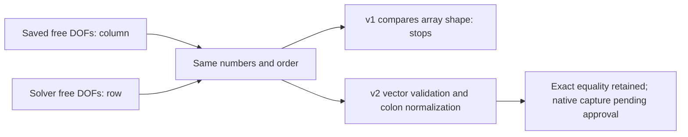

# Native capture v1 attempt — 2026-10-14

Approved exact four-file v1 delivered to CITPC12/AD\xw436, C:\Users\xw436\jobs\E011_PT_20261013_v1. Source149136231182f20fae643a662b53d44639f27c9a, runner97a9434ec5243e481da6da15a0accdb497c09d8525b82405370ce1bebfae791b. Upload size/hash matches; MATLAB checkcode no syntax errors. Launch UTC11:03:10.1905556Z wrapper22788, CPU single thread, WMI detached. First script invocation blocked by local script policy and did not execute; verified absent process/receipt, then invoked with a process-local execution-policy option, without system policy changes.

Execution verdict: FAILED_PRE_ADMISSION. On first c83-last-accepted state, DOF shape-sensitive equality assertion failed before any u/d Newton call. No directions or phase captures completed, no history commit; capture_finished.json absent. Fresh Get-Process found no wrapper22788 or MATLAB remaining. Logs and source/process verification stay in local run folder; original E011/tight/backtracking outputs remain unchanged. This is a diagnostic-runner identity-check bug, not a negative numerical experiment or solver-convergence result.

Cause: native dofs.m makes row vectors from 1:num_dof/setdiff; partition_residual.m canonicalizes active DOFs into columns. Four saved states have exactly identical index values/order to the reconstructed native boundary DOFs: free-u172916, free-d86505, crack251. Shape differs N×1 vs1×N. Identity proof: phase_tangent_preparation/dof_identity_orientation_proof.json, source hashes in failure_process_and_source_verification.json.

Minimal revision2: require vector inputs, canonicalize both sides with(:), preserve exact index and order equality. No mesh/state/free-DOF set/solver tolerance/budget change. Source and identity proof independently reviewed; original analytic derivative test remains passing. Fresh v2 bundle will use E011_PT_20261014_v2 and needs final-file transfer approval because the later user AGENTS requires a new approval for any changed version. Do not overwrite v1, remove its receipt, bypass the failed assertion, or automatically retry it.

Purpose remains quantitative cache→return→clip→raw-refresh attribution and native tangent audit. Those observables are still unavailable; prior offline source-equivalent findings retain their original boundary.
