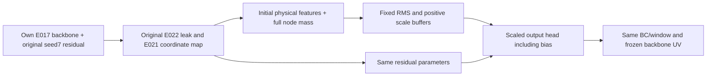

# E023 implementation and nontraining evidence

Only output-head input parameterization changes. Outer `HeadScaledUV` keeps all existing residual parameters and stores284RMS+284D values as buffers. Both normalized components and physical correction call `scaled_raw`; bias is scaled along with the283hidden features. No separate unscaled prediction path is used.

CPU float64/two-thread/1024-node calibration accepts xy/mass, original hidden features and knownUs; it has no target argument. Initial-gradient preflight accepts target separately to verify the coordinate transformation and does not feed D. Real traces and full three-state sampled streams are local; compact summary in nontraining_checks.json.

All initial residual tensors match E022, residual564029parameters,total1688839 unchanged. The new full-model digest additionally binds the two buffers. Three state scale ranges are approximately c20[2.9424,1970.81],c60[2.4553,1565.19],c83[2.1966,1925.27]. None of284columns is zero/floored in these original initializers. These are calibration facts, not learned accuracy gains. Initial UV vs corresponding unscaled E022 initializer maxdifference is0 for allthree. Saved-backbone CPU reload roundoff remains<=1.263e-15.

41checks passed/0skipped:20unit+E022regression,19strict temporary completion decoder cases,1coherent D/s/checkpoint/hash forgery rejection,1formal-nativeE022profile refusal onMac. Fixtures explicitly declare fake step/runtime metadata and never take optimizer parameter steps; no candidate training evidence. Nonzero synthetic heads prove function equivalence and gradient coordinate relation, both coefficient signs are covered. Three actual full-node gradient preflights match within5.42101e-20; peakRSS776585216bytes(<.724GiB). Three actual10000sampler streams match frozen controls. Three final-source validate-onlyCLIs passed; emptyaggregate returnsINCONCLUSIVEexit3.

Strict actual-used10000LR, PRE_UPDATE chronology, seed/state/reference/oldcontrols, sampling, all finalUV/strain/rho/baseline/support metrics and model reload checks retained. Eleven per-row artifacts include two new files, all ten nonreceipt files SHA-bound in actual producer archive. The decoder independently recomputes initial scales/gradient audit, checks actual final buffers and class then UV; coherent new hashes cannot qualify a forged scale. All four envelopes bind rule/E022 pairing and both new SHA fields.

Mac2.11nativeLR differs from original formalE022 at7425entries, max7.5894e-19, first1129; strict producer-native check refuses it. Original strictMac reference-rho/numerical exceptions unchanged. Formal preflight/CUDA runtime, producer execution and scientific improvement have not occurred. Next is independent exact-source Code Ready; a later separate production plan must handle allthree formal preflights and exactpackage approval.

Independent Code Ready completed for exact sourcec4ceb5d; no blockers. Independent real3state sigma formula and nonzero scaled-checkpoint decoding pass. See code_ready_review.md; formal producer qualification remains pending.
