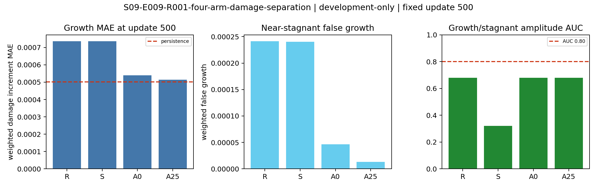

# S09-E009 producer result and next repair

## What was run

The authorised Taobo run used reviewed commit
`bc1309c75a2309e8b5e0fa00d474605a333d0379`, packet-manifest SHA256
`1658d2a2acc67c279b06e3e7965186bc1616aec50d6ee05179ff2606160272a6`
and resolved-config SHA256
`17972245713a1c32388d52f9cbcb91095ee997a3d6dfd3cb6915e1ba3b98673c`.
It compared the frozen `R`, `S`, `A0` and `A25` arms at exactly 500 updates
per arm. The learned mapping remained

`(d_s00, [H, alpha_bar, q_prev, f]_s00, prescribed s00..s05 path, fixed mesh/material/boundary)`
`-> (d_s04, [H, alpha_bar, q_prev, f]_s04, u_s04)`.

The only equation residual was the native-Q4 AMOR mechanical-equilibrium
residual on free displacement DOFs at the predicted peak state. The run did
not impose damage stationarity, the fatigue-history evolution equation or the
full incremental variational inequality, so it remained a limited PINO screen.

## Execution and evidence validity

The producer finished normally in 387.85 seconds. All four arms reached
`COMPLETED`; each contains 500 optimiser rows, 500 gradient rows, seven fixed
evaluations and an update-500 checkpoint. All hard-constraint violation counts
are zero. The replay numeric gate passed and the cross-arm comparison is
eligible. The archived legacy direction-stream hash did not match the new
stream, but this was a predeclared diagnostic-only identity and all frozen
numeric replay clauses passed.

The complete 17 MB run directory and staging evidence were retrieved in one
tarball with SHA256
`69b81db5535f9b36c879deba9c4685f77a3340f560528b987ce38bffeb435891`.
Local verification passed all 38 remote-manifest hashes, every shared and
per-arm receipt hash, row count, terminal receipt, config identity and the
byte-identical archive receipt. This establishes a valid execution and intact
evidence transfer; it does not determine scientific success.

Tracked exact summaries are retained under `results/`: the completion receipt,
decision metrics JSON, decision table CSV and producer decision PNG. Complete
incremental logs and checkpoints remain in the local retrieval archive.

## Frozen update-500 result

| arm | growth MAE `G` | false growth `F` | amplitude AUC | `L_P` | `L_judge` | spatial median |
|---|---:|---:|---:|---:|---:|---:|
| `R` replay | 7.36394e-4 | 2.41473e-4 | 0.68 | 0.266731 | 0.695180 | 0.01758 |
| `S` scalar data | 7.36049e-4 | 2.40329e-4 | 0.32 | 17.3257 | 0.693453 | 0.02512 |
| `A0` damage anchor | 5.39644e-4 | 4.65824e-5 | 0.68 | 2352.52 | 0.651245 | 0.08311 |
| `A25` anchor + physics | 5.14460e-4 | 1.32370e-5 | 0.68 | 0.720172 | 0.701712 | -0.00798 |

| arm | `L_D` | `L_U` | `L_H` | `L_P` |
|---|---:|---:|---:|---:|
| `R` replay | 1.998964 | 0.263484 | 1.581573 | 0.266731 |
| `S` scalar data | 1.998352 | 0.256551 | 1.582475 | 17.325710 |
| `A0` damage anchor | 1.995096 | 0.168627 | 1.524286 | 2352.520722 |
| `A25` anchor + physics | 1.999923 | 0.266870 | 1.595885 | 0.720172 |

Relative to replay, `A25` reduced `G` by 30.14% and `F` by 94.52%, giving
`Q_damage=0.19570`. The damage losses themselves were effectively unchanged:
`l_d` rose 0.031%, `l_dr` rose 0.065%, and `L_D` rose 0.048%. Amplitude AUC
remained 0.68 rather than the required 0.80. `L_P` was 2.70 times replay and
`L_judge` was 1.0094 times replay. Therefore the predeclared result is
`COMPONENT_SIGNAL_OR_MIXED_TRADEOFF`, not `RELATIVE_REPAIR_SIGNAL` and not a
confirmatory-P1 nomination.

The `A0 -> A25` comparison isolates the incremental physics direction within
the matched anchor rule. Physics reduced `L_P` by 99.969%, from 2352.52 to
0.7202, but increased `L_U` by 58.3%, `L_H` by 4.70%, `L_judge` by 7.75%, and
left amplitude AUC unchanged. This is useful evidence that beta 0.25 prevents
the anchor-only equilibrium blow-up, while the current equilibrium term does
not recover damage-regime or spatial discrimination.

## What the run learned

The improved mean-error pair is consistent with a small, weakly
cycle-modulated positive increment. At update 500, the predicted
growth/stagnant amplitude ratio is 0.9869, compared with the true ratio of
about 181.5 established before this run; predicted fields still have pairwise
correlation median 0.99949 and the within-cycle spatial median is slightly
negative. These metrics do not meet the frozen evidence standard for reliable
regime ranking or positive spatial alignment. AUC 0.68 is above chance and
does not mean that every prediction is uninformative. High pairwise
correlation alone also does not prove representation collapse.

The evidence does not identify gradient allocation as the sole remaining
bottleneck. The damage anchor was active for every update, and `A25` had a
slightly higher median actual damage-alignment cosine than replay, yet the two
damage objectives remained near their persistence-scale value. The exact
target fields motivate a separately normalised support/amplitude test: only
about 1.9--3.5% of weighted nodal area has positive increment, and for 14 of
16 cycles the top 1% of nodes carries at least 97.7% of squared target energy.
The area containing 90% of squared target energy is below 0.05% for 14 of 16
cycles. These target-only facts do not establish that background nodes
dominated the realised training loss or parameter gradients. They are
read-only measurements from the same frozen development packet, recorded in
`post_run_support_diagnostic_20261018.json`; they do not access a holdout or
change the E009 result.

## Field visualisation

The frozen update-500 checkpoints were replayed on the same 16-cycle packet to
reconstruct native-node damage fields. No optimiser step was performed. The
recomputed per-cycle weighted amplitudes agree with the archived scalar logs
to a maximum absolute difference of `1.0842021724855044e-19`. Exact checkpoint,
packet and output identities are in
`results/field_visualisation/field_reconstruction_receipt.json`.

The strongest target event, cycle 69, shows why the aggregate result is mixed.
FEM concentrates new damage at the crack tip. `R` and `S` are close to the
correct weighted mean increment but spread it over a broad smooth region;
their spatial correlations are only 0.050 and 0.053. `A25` produces a more
right-tip-biased shape and suppresses the broad background, but its weighted
mean increment is `1.276e-5` versus `2.564e-4` for FEM, and its local maximum is
`1.27e-4` versus `8.63e-1`. At the final listed transition, cycle 73, FEM is
nearly stagnant (`1.096e-6`) while A25 still predicts `1.275e-5`, about 11.6
times larger, with spatial correlation 0.065.

The total `d_peak` fields look visually close because they are dominated by the
inherited `d_pre` crack. Crack-development capability must therefore be judged
from `delta d = d_peak - d_pre`, its support, amplitude and spatial alignment.
The [field visualisation guide](results/field_visualisation/README_analysis.md) links the
final field, four-arm increment comparison, selected-cycle contact sheet and
16-cycle GIF. These are independent `s00 -> s04` mappings. Intermediate
within-cycle loading-state predictions were not stored and are not implied by
the animation.

## Selected next gate

The next repair should target damage support and amplitude explicitly while
keeping the evaluator, packet, architecture, physics residual and full-field
metrics fixed. The smallest causal comparison is a new pre-registered
development experiment with:

1. an exact `A25` replay control;
2. a support-balanced damage anchor that decomposes damage supervision into
   full-field error, active-support error and per-cycle increment amplitude;
3. the same support-balanced anchor without `L_P`, to isolate the incremental
   physics effect.

This three-arm comparison tests the combined support-and-amplitude addition;
it does not separately attribute an effect to either new term.

Weights must be derived from the frozen development targets before training,
reported in physical units, and normalised so that the support and amplitude
terms do not silently dominate. The original full-field `G`, `F`, AUC,
spatial correlation, `L_P`, `L_judge` and hard constraints remain the decision
axes. A target mask may shape the development loss but may not enter inference.
No checkpoint may be selected from the observed E009 transient metrics.

This next gate is design work only until its loss, arms, thresholds, budget,
identity rules and result hierarchy receive independent review. No new run or
fresh holdout is authorised by this analysis.

## Claim boundary

The result supports a valid component-level optimisation finding on one
16-cycle synthetic development trajectory. It does not establish rollout,
cross-trajectory or cross-mesh generalisation, FEM truth, state sufficiency,
architecture incapacity, full fracture-evolution PINO validity or real-road
applicability.
