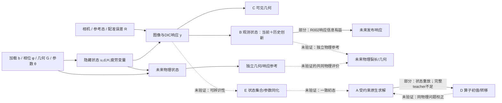

# 跨主线连接：从可观测响应到有预测价值的状态

2026-10-19，Europe/London。设计版本 `BRIDGE-PS-v1.0`；任务 owner：`01a15519-43bc-7aa0-bc1d-0e15dee89f73`。

**决定：主攻“当前整体响应＋局部历史创新”的预测状态接口。**先在现有发布 DIC 分支一次比较完整代表性队列，判断历史是否提供当前状态之外的预测价值；不等待 PIDL 全部完成。若历史无增益，保留当前响应强基线，停止扩展时间编码；跨线回退为原 A owner 的“算子给初值、受约束原生求解器校正”路线，待其现有求解与标签问题解决，不另开重跑。

这是第一性原理设计与交接任务，不是生产 owner、运行卡或已成立的科学结果。拟议检验是 **C3 / published experimental response** 的开发暴露基准探索，既不是物理疲劳预测，也不是道路证据。当前仅文档、已有小型记录只读分析及人工 fixture；所有真实拟合、模型前向、autograd、训练、FEM、profile、SSH、原始数组和新留出访问均未执行。

## 1. 原目标、问题与决策阶梯

原目标：从稀疏观测估计劣化并预测未来。当前问题：先找可观测量中对未来真正有用的状态信息，而非要求图像先唯一恢复全部 `d/H/θ`。处置 `continue`：这是目标的接口设计，不把“预测发布位移”替换成最终物理目标。

| 步骤 | 决定性问题 | 状态与动作 | 改变路线的结果 |
|---|---|---|---|
| D1 | 哪些已有连接成立、哪里缺信息？ | 已完成：复用原图、R002、A/D/E 原 owner 与论文核查；保留旧证据 | 排除重复修复和直接 mask→d 假设 |
| **D2** | 哪个完整比较能区分历史信息、表示、惩罚几何？ | **当前：本设计与人工接口检查完成，交原 B owner/HQ 定稿实现和审阅** | 不新增生产任务；身份、源版本或权限不符则返回 |
| D3 | 条件历史是否超过最强简单当前状态？ | 待原 owner 的版本审阅和本次执行批准；一次覆盖全部队列 | 增量稳定→保留时间状态；仅换坐标有效→采用简单表示；无益→停止时间扩张 |
| D4 | 该状态能否约束独立物理裂缝未来？ | 沿原 SCB/D01 设计，需同对象、加载同步和独立参考 | 独立对象/参考成立才讨论物理外推；不能由 D3 自动推进 |

不存在另一个 toy→微测→pilot 阶梯。D2 fixture 只检查时钟、对象、坐标与变换的实现风险；不检验预测假设。

## 2. 从物理状态与观测生成出发

设接受状态 `x_n=(u_n,d_n,H_n,a_n,...)`，其中 H、a 分别代表该模型的能量历史与疲劳累积变量，具体字段须由 producer 定义，不能互相改名。几何 G、参数 θ、加载/边界 b 和相位 φ 共同决定转移：

`x_(n+1)=F_θ(x_n,b_(n:n+1),φ,G)+w_n`，`w~Q` 代表未建模的过程差异；

`y_n=O(x_n,b_n,φ_n,G,camera_n,reference_n)+ε_n`，`ε~R` 是观测误差，θ 另有参数不确定性。

同一张表面 mask 可以对应不同 d、深度、闭合状态和 H；同一当前位移也可能由不同边界、刚度或疲劳记忆生成。反过来，某些无法唯一恢复的内部状态，对一个限定的未来观测可能有相同预测。这使“先求唯一全相场再预测”成为过强要求。

目标预测状态为 `s_n=ψ(y_≤n,b_≤n)`，希望在限定加载与跨度下，`p(y_future|past,b_future)≈p(y_future|s_n,b_future)`。这是**待检验的目标**，有限历史 ridge 比较不能证明充分性、Markov 性或物理内部变量恢复。预测状态思想有直接前作，不能作为本项目首创（Littman/Sutton/Singh 2001，§1 Eq.1；有限 POMDP 的定理不能直接套到连续断裂场）。

### 因果/信息图（设计图，非新测量）

看见：B 已有观测响应到发布响应的组件证据，A/D 有数值接口证据，独立物理预测边尚未建立。说明：应先验证跨接口的信息价值，不把所有路线硬接成一条流水线。不能说明：图中的箭头均已因果识别，或已达到道路预测。

## 3. 快照与本轮增量分开

原图为 `2026-10-19 16:54 Europe/London` 快照，MindMap 已按完整源层级重现，未修改旧图。源 SHA256 `784d13f5fc11eb254d043b73638db82a4990c5f66b9699f8e19834099b15af58`。

本轮只读核对 HQ `hq_state.json` 的 owner/cursor/约束，并读取 B 最近 2 轮、A/D 最近 3 轮、E 最近 1 轮；只摘直接用户授权、结论和路径。旧 quotaStop/夜间截止不是当前权限。live thread 的 failed/inProgress 仅是对话状态，不替代科学结论。

| 桥 | 已有证据 | 真实接口缺口 | 处置 |
|---|---|---|---|
| A→D | native-Q4 状态/算子重放；E017 核心 `5ac6b795…` 已审 | A 完整同物理接受轨迹/合格标签不足；D `s00→s04` 不是完整自主循环，β=.25仅机械残差 | 部分；不能凭总 d 相似认定演化学会 |
| C→B | R002 当前响应对发布场预测有益；D01局部组件保留 | C 的 mask/纹理开口、B 的发布位移不属于同一物理序列；独立几何、时间/相位与参考缺失 | 未验证；不能跨数据集拼轨迹 |
| B↔D 状态信息 | B raw历史变差，centered-history小幅最佳；D真实增量塌零/幅值与位置分离 | 没有共同网格/单位/驱动；能共享“信息价值检验方法”，尚不能共享物理状态或模型权重 | 主攻观测侧状态信息，D后续独立验证同一假说 |
| C/B→E→A | S03观测/坐标/可辨识性准备；F01结构验收已过、说明首停 | 观测算子、低维可辨识状态、R/Q/θ分离及合格正演均未闭合 | 长期潜力最高，当前不可端到端执行 |
| 实验室/合成→道路 | 已有实验/合成文件和道路观测候选 | 材料机制、环境/维护、加载、空间身份、独立实体时序不同 | 未验证；不以实验代道路 |

**更新事实：**R002 已完成，不沿用旧图的“正在准备”。D owner 后续只读状态有90项静态集成检查的 commentary，尚无完整最终提交/审阅回执，不升级为 Code Ready。A owner 成套修复准备已完成：源 `5bb172149b94788599cfc351cbe2fe7788710dc8`，39文件/61项人工检查/v3静审通过，执行关闭；Linux控制、全网格一致性与真实成本未验证，仍0条合格完整标签轨迹，机械成本敏感性估算不是已测提速。

## 4. 最多三个竞争候选

| 候选 | 绑定限制与真正干预 | 可证伪预期/新能力 | 可用资产、硬缺口与成本 | 判断 |
|---|---|---|---|---|
| **P 预测状态：当前整体＋局部历史创新** | 当前几何/统计可能混叠不同演化；原始历史冗余且惩罚方式变化。保留当前整体响应，将过去局部响应对当前信息的可预测部分剥离，再输入同一个转移探针 | 在共同当前场锚点、同一学习/选择规则下，额外历史能改善未来真实发布增量和局部变化；若只中心化有效或替换历史也有效，时间机制不成立 | R002 19组/1144起点/H10、40与runner已在；无需新FEM。身份/加载/独立裂缝参考缺口限制为发布基准。拟≤0.5 CPU墙钟小时/0GPU | **唯一当前主攻**；可直接区分关键解释，低成本、有明确终止结果 |
| **N 受约束混合：D给初值，A保物理** | 纯网络目标无法同时保场/反力/历史，数值求解贵。用相同接受态和同一物理算子校正预测初值，比较总成本 | 全轨迹精度不降且含标签/训练/校正的总成本下降；若共同机械修复解释全部收益，则不归给网络 | 原A完整3600子步/12GPUh/136CPU墙钟h方案；R1第2步首停，仅1新接受态，标签不足。需原owner修复和重新授权 | **明确跨线回退**；物理约束价值清楚，当前不可绕过首停执行 |
| **I 观测等价状态集合→物理同化预测** | 单mask/位移不能唯一确定d/H/θ；保留与观测一致的状态集合，用已知加载下未来独立参考判断预测可辨识性 | 不必恢复唯一参数而得到有用物理预测；若等价集合的未来分叉大、R/Q混淆仍在，则需补新观测而非收窄后验 | S03与SCB设计、Lu likelihood位置、Sasaki/Sueki等全文；缺同对象完整时序、R参考、冻结合格正演。当前端到端成本不可可靠估计 | 长期科学价值最高；**不伪装当前可执行**，暂不主攻、不新建同化生产线 |

公开替代资源更新：ISTRUST（10.1016/j.compositesb.2024.111863）已有作者代码/CV预训练资产与官方3.66GB、9试件双相机至失效发布说明，原论文owner已核查；尚未逐图取回/验证/运行。其目标是RUL，不是未来裂长、tip或mask，MC dropout也不是独立观测误差校准。本任务不下载该数据、不另开复现，沿原open_pipeline_search_20261019/RESEARCH_HANDOFF.md作为相邻备选，不能替代P的目标。

排序为定性判断，不伪造可比的概率或总分。P不依赖A先成功，N也可独立产生数值求解论文能力。P成功只使I更值得做，不自动证明I。

## 5. 主攻机制：保留能测到的驱动，不把坐标选择当作新信息

原R002每个时刻统计为 `q=(μ_full[2],σ_full[2],μ_band[2],σ_band[2])`。定义整体 `g=μ_full`，局部相对 `r=(σ_full, μ_band−μ_full, σ_band)`，每个r为6维。

`(g,r)`与原8维统计线性可逆。**保留g的坐标变换不增加信息**；丢弃g才是信息限制，而且g可能包含真实加载/变形，不能称其全为相机漂移。Ridge用普通各向同性惩罚时，坐标变换会改变偏好；本轮先用惩罚拉回复核控制这个混淆。设原训练侧标准差矩阵为Dq，z=Tq的标准差为Dz，使用标准化z系数时惩罚矩阵必须是 `Dz⁻¹ T Dq² Tᵀ Dz⁻¹`（intercept不罚），均值同步变换；不是重新用单位阵。

共同基础 `b=span_progress` 为12维，仍含三时刻跨度及其平方、元数据与起点发布进度；不得称“完全无历史”基线。当前 `c=[b,q_t]` 为20维，**坐标顺序、当前块的标准化/惩罚与C_RAW完全相同**；g/r只用于构造过去的局部变化，避免当前块换惩罚伪装成历史收益。历史差分 `h=[r_(t−20)−r_t, r_(t−10)−r_t]` 为12维，未除以物理cycle。

每个训练折只用输入拟合 `m(c)≈h`（固定标准化ridge α=10；按原规则group等权，均值/尺度用该训练侧），得到 `e=h−m(c)`。候选输入为 `[c,e]`，32维，主预测器仍是原多输出ridge，预测16×16×2增量。该残差化并不创造新信息；它让固定有限探针把正则化预算集中到过去相对当前的新增变化方向。结果最多支持“这套输入与固定探针有额外预测价值”，不能证明非参数条件互信息、真实疲劳记忆或物理状态充分性。

主要竞争解释：当前相对统计已经足够；真实历史只是冗余/噪声；收益来自均值/标签发布进度；收益只是更好的惩罚几何；所有方法共享当前场锚点，主要复制当前场。下述一次比较同时处理，不在结果后选新模型。

## 6. 一次完整的决策规模验证（拟议，未执行）

### 6.1 版本、数据与语义

复用B源 `5ea77160e8bb72a1b3b7a2d91d9bcf09282f5011`，见原 `retrieved/code/runner.py`、`experiment.md`、config和manifest。附属 `source_manifest.json` 记录本轮实际核对的文件哈希；本设计commit并不是未来生产代码commit。原B owner须在其独立worktree实施差异并审阅该确切版本，保留旧协议和旧结果。

队列冻结为R002相同19个**已开发暴露发布组**、1144个起点、H10/H40共2288案例，历史偏移[-20,-10,0]、stride5、原cap80/最少6和全部既有排除。完全复用manifest，不增加/替换组、不读新holdout、不换中止规则。不读取原始XLSX/CSV、author未来预测、保护数值或别的案例。180个既有输入约2.31GB沿原B只读store，具体许可由原owner核清，不因本设计自动延伸。

发布步不转成cycles；当前native field为所有输出共用的锚点。目标为 `Δv=v_(t+H)−v_t`，原16×16均值池化训练目标，上采样后在原native grid和原first-frame band评分。没有目标裂长/相场d，也没有自主多cycle rollout。H内不使用未来观测更新；未来实际载荷未知，不补造条件加载。

### 6.2 六个学习臂＋一个等价性复核

| 名称 | 维度 | 作用 |
|---|---:|---|
| C_RAW | 20 | 原current_response精确重放，强简单当前响应 |
| H_RAW | 36 | 原history_response精确重放，识别直接堆历史的成本 |
| C_REL | 18 | b＋当前r；补上R002缺少的“仅当前中心化”公平对照 |
| H_REL | 30 | 原centered_history精确重放；与C_REL只有过去局部相对响应不同 |
| **H_INNOV** | 32 | c＋训练侧条件化的真实历史创新；唯一预定主候选 |
| H_DONOR | 32 | c不变，将创新换为同当前状态邻近、不同训练发布组的历史；控制额外维度/平滑效应 |
| H_RAW_PULLBACK | 36 | H_RAW改写为(g,r)坐标并拉回原惩罚，不另调参/拟合；预测应数值等价 |

P=持久当前场、S=原native secant均保留。主对照 `B*` 在每个outer group/horizon的**内层**上从P/S/C_RAW/C_REL选出，平分时按P、S、C_REL、C_RAW固定优先次序，评估前冻结，不按未来阶段选法。各臂使用相同组权、原3个α `[0.1,10,1000]`、相同内折（development排序每4个一组作inner valid），不加seed/架构/α搜索。

H_INNOV的m只用inner-fit输入得到，再用于inner-valid；最终只用outer-development输入重拟合m，不用held组估计均值、尺度、邻居或m。预测器的所有标准化和惩罚同样折内。目标normalizer严格沿原训练侧增量与`1e−6` floor，不能用held future确定。

H_DONOR：在相应训练侧标准化c后，以Euclidean距离找不同发布组的最近donor，tie按(group,origin_stage,case_index)字典序；donor只提供其历史创新，当前c/输出锚点/目标均不动。训练行禁止自身发布组作donor；valid/test只从对应训练侧取donor。不用未来target匹配，不从整个测试队列学近邻。这是人为破坏对应关系的诊断，不是有效物理输入或严格条件独立检验；单次替换不能给精确随机化p值。

不增加“反转历史顺序”的伪对照：对线性ridge仅置换列本就应等价，无法证明时间因果。也不把差分重参数化后的小幅改善称新增信息。

### 6.3 一项主读数、结果解释和尺度依据

主loss沿R002：`L=.5 full_NMAE + .5 fixed-band_NMAE`；每发布组先等权汇总起点、再等权H10/H40、再19组等权。主效应 `Δ=L(B*)−L(H_INNOV)`，正为改善；同时保存每组/每H原值。

本研究选择**探索性路线判断**而非伪造物理成功门槛。预定主读数是Δ；报告19组paired差、全范围、逐组删一的Δ范围以及按完整发布组重采样10000次/seed20261019的经验范围。物理组独立性未知，因此该范围只是本发布基准的重加权敏感性，不能称总体置信区间或独立试样显著性。不得按帧bootstrap制造精度。

已知R002 current=0.880348、centered-history=0.873625，名义差仅0.006723 NMAE，且8/19组改善；这给出“尚不足以改路线”的现成参照，不把它偷偷改成自然物理容差。没有独立参考噪声，不能编造5%/10%物理门槛。

| 一次结果 | 允许判断与行动 |
|---|---|
| Δ>0，跨H/逐组删一方向稳，H_INNOV优于H_DONOR，增益与上述小差距相比有清楚量级；局部增量也有对应改善 | 支持保留条件历史组件，原owner定量解释量级；值得将这套状态接口纳入已有SCB物理设计。仍不叫科学突破/必要历史 |
| 只有C_REL优于C_RAW，而H_REL/H_INNOV无追加价值，或pullback显示差异仅惩罚来源 | 采用当前简单表示；停止时间模型扩张，不能称“历史被证必要” |
| H_INNOV与H_DONOR接近、Δ小或对组/H敏感 | 时间信息解释未获支持；不扩维/换网络救结果，保留当前强基线 |
| 全场均值改善而局部增量/幅值/位置不改善，或增量近零 | 仅报告对应组件，不能宣传演化/局部化能力；回到当前状态信息或A→D回退条件 |
| 关键身份/源/等价重放失败、超预算、原料不符 | 本次证据不可解释，首停，保留回执；不新ID自动重试 |

执行时主结果只按 `Δ>1e−11` 记为该开发基准上的正向均值，`Δ≤1e−11` 不记正向；这只是数值零容差，不是物理意义阈值。路线处置的“方向稳”具体指两个Δ_H和19个逐组删一Δ均>1e−11；“对应历史有用”的诊断为H_DONOR−H_INNOV的同权loss差>1e−11。主Δ为正但这些诊断不支持时，保留正向组件结果、处置为不扩展时间模型，不能把诊断改写成主均值为负。改善量级及其相对R002名义0.006723差距须原样呈报，不用数值正号宣布突破。

这里的方向与量级是路线判断依据，不是多项投票的正式PASS门。若要正式确认，须先解决独立物理单位和参考，依据参考重复性定δ并冻结新的confirmatory协议；不能将本次已曝光19组重新称盲留出。

### 6.4 防止“总场相似=预测成功”

必须同时出真实Δv参考、B*预测Δv、H_INNOV预测Δv及各自误差图，用共同色标。额外报告：每通道均值增量误差；去全域均值后的空间增量误差；原fixed-band误差；预测/参考增量L1质量比；正负变化分布与最大局部误差位置。位移增量允许正负，**不得套d不可逆截断**。接近零的参考按原训练normalizer报告，不事后删掉难例。

全部19组×两个H都有分数组和origin-to-horizon曲线。每组固定显示排序后中位起点及该组最差case（后者标为事后失败诊断），不只挑梁6或最佳图。至少一张组级成对主读数图；所有图由保存预测复算，不另前向。总场图只是锚点语境，不能遮蔽增量错误。R002的future projection只作输出基底诊断，不叫MAE理论下界。

### 6.5 计算、存储、停止与依据

| 项目 | 拟议上限/工作量 | 依据 |
|---|---|---|
| 真拟合 | 6×19×2×(3内层α＋1最终)=**912**个闭式ridge solve；m最多19×2×2=**76**个输入侧solve | 不含神经训练/autograd；同一m供3个α复用 |
| 等价性复核 | 38个outer/horizon已存coef变换及评分；0额外fit | 原惩罚拉回应保同一函数 |
| 墙时 | **1800秒，1 CPU thread，0 GPU小时** | 原9臂1368fit/342档案实际236秒；6臂线性估约157秒，加残差化、完整校验/出图后留>10倍余量；不是已测本包性能 |
| 内存 | **8GiB RSS/地址空间上限** | 原观测RSS约1.19GiB；输入LRU沿原上限，不积累native全部target |
| 存储 | 新输出≤4GiB＋归档≤4GiB；只读输入约2.31GB复用，不重复下载 | 原342预测档案打包约0.406GB；本次228学习档案＋38派生复核＋图，按更大余量预算 |
| 执行者/地点 | 原B owner，原有Taobo CPU路径；具体producer/RunID由其最终卡核清 | 本任务无SSH/资源预检/执行授权；不替代GPU或换机器 |

独立控制进程含输入校验、拟合、评分、出图全包1800秒；RSS/输出监控在超限时停止整个本次job。首个异常、非有限值、hash变化、案例不一致、真实语义警告或重放差异超阈值即停，不续跑剩余折、不放宽阈值、不换机器。原三个重放臂逐case评分与保存预测复算沿R002的最大绝对差 `<1e−11`（原verify_results.py:29/42）；等价变换评分也用该同一阈值，超限即停，不放宽。完成2288×(6学习＋P/S＋等价复核)=**20592**个case-method评分；B*是从保存输出确定的派生选择，另2288行，共22880行，均另存选择证据。全部取回/独立重算后才解释。

### 6.6 此方案到可运行代码之间还剩什么

交付已到**完整可实现、可审阅的设计**；未伪称Code Ready。原B owner需要：复用原runner/loader/score，增加C_REL、H_INNOV/H_DONOR和广义惩罚等价复核；核验所有折内处理及强基线选择；绑定确切代码/config/manifest/协议版本做独立只读代码审查，再将一个具体运行包交HQ核清本次授权。普通开发可由原owner继续，不能以本任务的fixture测试取代生产实现审查。本任务不发消息或派生产任务。

## 7. 四项跨owner交接（由原HQ协调）

| 原owner/接口 | 上游输出什么 | 下游实际需要什么 | 哪已有证据 | 哪次共同比较验证连接 |
|---|---|---|---|---|
| **B** `01a10e77-8832-7371-b4cc-e5cbdadceced` | R002 manifest、状态统计、当前锚点/两H输出与逐组评分 | P中32维origin-only状态、可追溯clock/support；不可输出“真实d/H” | R002 README/源5ea77160；19组/2288case已取回复核 | 本设计六臂＋同惩罚复核，原owner实施一次，不复制原实验 |
| **D** `01a11ae2-f669-77a0-ae6f-b141bee5e72b` ↔ A | native accepted/pre/post状态、真实Δd与幅值/形状 | 输入是否含所需H/疲劳、加载相位；非零幅值与空间定位分别可用 | S09-E017核心5ac6b795；next_gate_execution_contract_20261019.md；仅no-I/O集成 | 现有E017先由原owner按其权限完成；后续同一producer输入嵌套删状态比较须另定，**本轮不并入/加臂** |
| **A** `01a14bbc-c8fd-7bd2-85fe-e0d6cbadc85d` → D | 同一物理算子的完整接受态与前态、mesh、BC、θ、trial/accepted history、reaction/residual与成本 | 同状态合格标签、完整轨迹、误差可比基准与可复用校正器 | hybrid_constrained_design_20261019/execution_plan_v1.md、producer_run_stop_v1.md；R1仅1态；性能修复源5bb172149b94788599cfc351cbe2fe7788710dc8、39文件/61检查/v3静审仅准备通过 | 原完整直接/经典/网络初值全轨迹比较；共同机械修复不能计为网络收益；**不重跑/新profile** |
| **C-D01** `01a13639-1044-73c2-811a-3a3d1366c9c2` → B/E | 14阶段/11相邻转移、固定支持、mask与参考歧义 | 整幅独立可见几何、同状态复拍/坐标误差、加载同步；mask不当d | S03-E016-D01/fourteen_stage_extension_20261017/analysis/README_analysis.md | 沿已有D5整幅参考/状态信息比较；不调质量权重、不重做MD03 |
| **C-MD03** `01a11abb-c9d0-75c1-ad93-56246a882568` | 固定位置纹理位移候选、原图对照 | 同位置DIC/独立开口参考与坐标关系 | 89/132/175、1.576图像px是纹理跳量 | 原owner的对应参考核对；未确认前不得变成物理裂宽/预测label |
| **E-S03** `01a11aca-9458-7523-a1fe-aefee5baa859` → A | 观测语义、ROI、坐标、低维未知量与不可辨识集合 | 与A完全相同的状态/边界及已校准观测算子，R与Q分别说明 | F01结构验收已过、说明歧义首停；B003/C/D未授权 | 保留F01首停；任何未来同化检验需共同未来独立响应，不能重复验收或读保护数值 |
| **B/SCB**（同B owner）→物理验证 | 原始frame-cycle-load-phase与core/specimen映射，独立裂长参考及重复误差 | 同状态观测与未来参考、已知未来加载条件、可辨识R/Q | 原SCB experiment_design_v0.1.md；当前资料未齐 | 原SCB跨core强P/S/A/B/C方案，预测独立裂长CRPS；本P只提供响应表示候选，不改其对象/审批邮件 |
| **道路F**（既有PaveTrack/LTPP/MnROAD owners） | 同一路段跨时序、配准与维护记录 | 非重铺/修补导致的真实演化、环境/驱动和独立参考 | 现有候选/局部对应与负结果保留 | 暂无合格共同道路比较；先补具体接口，不以C静态分割或合成模仿替代 |

精确A/D/C/SCB本地根见`source_manifest.json`。原HQ只接收该清单，本任务没有改变HQ状态文件、原owner源码/协议/运行状态，也未发送消息。

## 8. 真正人工/外部依赖与停止边界

当前P的资料、原型和方案可审阅；若要计算，需原B owner完成版本实现审阅与HQ核清本次执行授权。已有一般预算不覆盖其他owner较晚的no-run/no-retry。

独立物理结论仍需：真实试样/core关系与加载时钟；独立裂长/整幅几何参考及其不确定性；同状态采集误差。需要人工盲审或裂尖复测时由用户/获准人员完成，AI不补造。SCB/作者数据请求由用户按已有草稿处理；本任务不发信、不填表、不购买、不申请访问新私有资料。没有待用户下载的新论文。

如果没有可区分R/Q的信息，不能把更宽区间当成功；如果P失败，也不意味观测无用或全场损伤不可预测。停止的是本次条件历史机制，保留当前状态、负结果与原A/D独立路线。

## 9. 本轮证据与实现状态

`source_manifest.json`记录确切本地复用、hash和会话范围；`plan.json`记录6臂与预算/权限；`interface_fixture.py`与`test_interface_fixture.py`只使用手写数组和符号字段，检查发布步/cycle拒绝混用、mask/d拒绝混用、对象/support、origin截断、当前/历史信息权限、保留整体均值、可逆变换和惩罚拉回。它们**不读科学数组，不拟合预测器，不调用模型**。

研究结论：**唯一推荐路线已选择，完整验证设计已完成；新科学结果尚无。**全部参考论文只支持设计组件，不证明本项目新能力/新颖性。文献综合与原稿链接见Obsidian《Deep Research - 跨主线连接与预测状态突破设计》；任务短记见《跨主线连接与第一性原理突破设计》，单一Roadmap收录。
