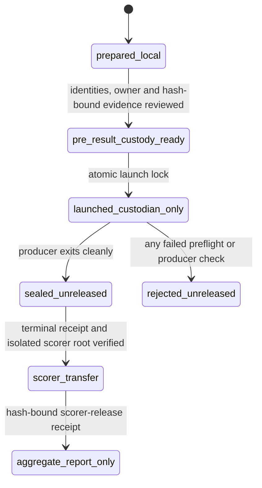

# U0.1225 independent-test custody protocol

This is a pre-result custody protocol for the single prepared U0.1225
condition. It preserves a possible strict independent-test role only when the
development operator is actually excluded from the protected archive, the
custodian process, and the scorer handoff. It does not start FEM, train a
model, alter the frozen producer, or establish a physical benchmark.

## Current state

The package is deliberately inert. Its policy, role evidence, and owner fields
contain placeholders, so `run_u01225_custodian.ps1` must stop before creating a
custody root or MATLAB process. The current status is **prepared, not
strict-test eligible**.

A run may start only after a pre-result amendment changes both
`policy_status` to `PRE_RESULT_CUSTODY_READY` and `strict_test_role_status` to
`STRICT_TEST_CUSTODY_READY`. That amendment must bind a hash of
`prelaunch_custody_evidence.json`, which records the complete development
roster, a distinct non-administrative custodian, a distinct scorer, the exact
protected-parent owner, the ACL exclusion claim, no development observation or
timing signal from the custodian process, and a scorer-only transfer route.
The wrapper checks the current parent ACL and exact owner again immediately
before it creates the child root.

A declaration alone is not sufficient evidence. Before launch, independent
review must establish that every development identity is excluded from the
parent and is not a custody administrator; that the named custodian and scorer
are independent of development; and that development cannot observe the
custodian's process or infer a result from elapsed time. Software checks the
local ACL visible at launch; it cannot create an independent identity, prove
host account governance, or stop a privileged administrator from overriding
Windows access control.

## Frozen assignment

`custody_policy.json` fixes the test unit as the whole U0.1225 parameter
condition. Development conditions are U0.11, U0.115, U0.12 and U0.13; U0.125
is validation. No state window, branch, repeat, or derivative of U0.1225 may
move into development or validation.

The custody parent is fixed as `C:\q4runs\fixed_weight_custody`; the only
allowed child is
`C:\q4runs\fixed_weight_custody\u01225_independent_test_20261024_v1`. Its
owner is not described generically: the policy must name one exact
non-development owner, limited to the custodian, `NT AUTHORITY\SYSTEM`, or
`BUILTIN\Administrators`, and the wrapper compares the actual owner to that
value. The independent review must also establish that no development identity
belongs to the administrator route permitted by the policy.

## Custody state machine

`rejected_unreleased` is terminal for this candidate: the lock remains and no
retry, extension, replacement run, or threshold change is allowed. A
`sealed_unreleased` archive is not a development-facing result.

## Remote deployment and launch

The designated custodian, not a development operator, performs these actions
on the Windows FEM host.

1. Copy the package to temporary staging outside the frozen source snapshot
   and every FEM archive. Before execution, compare
   `run_u01225_custodian.ps1` with a reviewed immutable Git revision and
   verify every payload listed in `SHA256SUMS.txt`. The custodian wrapper is a
   bootstrap trust anchor, so it is intentionally excluded from the manifest
   it verifies and needs this separate review check.
2. Before any candidate output, replace all role and owner placeholders; create
   the evidence receipt from independently checked access facts; update its
   hash in the policy; set the two READY statuses; regenerate
   `SHA256SUMS.txt`; update the custodian wrapper's two pins; and obtain a
   fresh independent static review of that exact package. A missing or draft
   evidence receipt fails before a custody directory exists.
3. An administrator first provisions the fixed custody parent. It must be ACL
   protected, owned by the policy's exact owner, and contain only the named
   custodian, `SYSTEM`, and `BUILTIN\Administrators`. No development identity
   may create, enumerate, or read a child. The designated non-administrative
   custodian runs the reviewed wrapper. It rechecks the ACL and owner, creates
   the previously absent child root, strips inherited access, copies only
   hash-verified payload files into `launcher`, and atomically creates
   `launch.lock.json`.
4. The wrapper starts MATLAB with stdout and stderr redirected into protected
   logs. The overlay sees the lock through
   `FW_U01225_CUSTODY_LOCK_PATH`, verifies the policy, prelaunch-evidence,
   scoring-protocol, and release-wrapper hashes, and writes output only beneath
   `archive_root`. The wrapper never opens a target payload or event record; it
   observes only the MATLAB exit code, expected archive path, and archive
   manifest hash.
5. A hash-bound terminal acceptance or rejection receipt and its sidecar are
   written to `receipts/`, outside the FEM archive but still custodian-only.
   Once custody-root creation begins, the wrapper prints only
   `CUSTODY_TERMINAL_RECORDED`; it does not print a result, event value,
   archive path, log, or outcome-specific exit code to a development caller.

The launch lock persists after success, failure, interruption, or host loss. A
later invocation sees the root or lock and fails. It never removes output or
attempts recovery.

## Scorer transfer and publication timing

`scoring_protocol.json` fixes inputs, horizons, normalizers, comparators,
checkpoint-selection rules, and the aggregate-only report before any archive
release. It neither trains nor scores a model.

After a `sealed_unreleased` terminal receipt, the custodian can invoke the
reviewed `run_u01225_scoring_release.ps1` from the protected launcher. That
script requires the hash-bound terminal receipt, launch lock, policy,
prelaunch evidence, and scoring protocol. It verifies that the pre-provisioned
scoring parent is ACL protected and excludes development, creates one atomic
release lock, copies the opaque archive to the fixed scorer root, verifies the
source and copied archive manifests and every manifest member by SHA-256, rejects
reparse points and unmanifested files, removes the custodian's normal ACL grant
from the scorer root, and writes a hash-bound scorer-release acceptance or
rejection receipt outside either archive. It prints only
`SCORING_RELEASE_RECORDED`.

The scoring root admits the named scorer, `SYSTEM`, and administrators only;
the non-development custodian may remain the Windows owner for custody audit
but receives no normal ACL grant after the handoff. Development receives neither
the archive, terminal receipt, release receipt, fields, event values, nor
process timing. The scorer may later release only the predeclared aggregate
score report. A score, a lower loss, or a sealed synthetic archive is not a
physical-validation claim.

## Limitations and remaining external evidence

A common Windows identity cannot establish blindness. Neither can a mere local
policy or a checked hash. The condition remains prepared-but-unrun unless the
following are evidenced before launch: an immutable reviewed Git anchor for the
bootstrap wrapper; named non-development custodian and scorer accounts; the
complete development roster; exact protected-parent and scoring-parent owner
and ACL evidence; no development administrator or process-observation path; and
an independent review of the activated pre-result package. The wrapper cannot
protect against an administrator who chooses to override ACLs, and it does not
turn synthetic FEM into a physical benchmark or authorise training.
