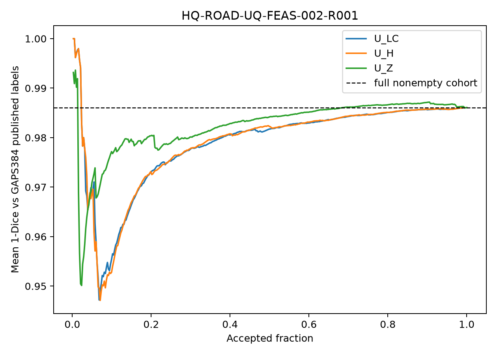

# Result claim audit and final decision — HQ-ROAD-UQ-FEAS-002-R001

## Purpose and bounded claim

This one-factor package asked whether replacing the D1 scratch U-Net with an ImageNet-pretrained ResNet18 encoder makes CRACK500→GAPS384 published-label transfer and selective acceptance feasible. It can diagnose two named public sources. It cannot establish physical crack truth, crack width, independent-site generalisation, field safety or human-review utility.

## Result

| Quantity | Frozen criterion | Observed | Decision |
|---|---:|---:|---|
| Nonempty GAPS images with Dice>0 | at least 287/382 | 331/382 | F1 component passes |
| Degenerate predictions | fewer than 191/382 | 0/382 | F1 component passes |
| Full-cohort mean `1-Dice` | descriptive | 0.986069 | absolute overlap is unusable |
| `U_LC` risk at first 95 | at most full risk −0.05 = 0.936069 | 0.975264 | F2 fails |
| `U_H` risk at first 95 | same | 0.975482 | F2 fails |
| `U_Z` risk at first 95 | same | 0.978837 | F2 fails |
| `U_Z` versus `U_LC` | `U_Z` strictly lower | `U_Z` higher by 0.003573 | F3 fails |

F1 passes because the repair removes empty/full outputs and produces some overlap on 331 images. That is a real component improvement over D1's collapse mode, but `Dice>0` is deliberately permissive. The magnitude is decisive: GAPS mean Dice is only 0.01393, median 0.00844, and 375/382 images have error at least 0.9. Both empty-reference images receive false-positive crack predictions. By contrast, the same checkpoint reaches mean Dice 0.73929 on A validation and 0.64640 on A test, so the failure is source/target specific rather than a globally untrained model.

## Decision-facing visual

**See:** all three accepted-risk curves remain near 0.95–1.00; at the frozen 25% budget they are approximately 0.975–0.979, and `U_Z` is the highest-risk ordering.

**Therefore:** the backbone package removes the all-empty failure mode but does not create useful published-label overlap or a useful acceptance queue on GAPS384. Simple confidence is marginally best and complex source distance adds no value here.

**Does not show:** whether the remaining disagreement is primarily source appearance or thin/width/location label convention, because the old/new model and CFD/GAPS source changes are not yet crossed.

## Claim audit

- The frozen final verdict `FEASIBILITY_NO_GO` is supported: F1 passes but necessary F2 fails.
- Do not rescue the result with the small low-coverage dip, post-hoc threshold changes, tolerant-overlap scores or a different acceptance fraction.
- Do not say the pretrained backbone fixed reliable transfer. It fixed degeneracy while strict overlap remained extremely poor.
- Do not retain `U_Z` as the preferred score; it loses to the simpler `U_LC` at the frozen budget.
- Do not open Road420. CFD and GAPS384 are development sources for the next mechanism analysis, not fresh C evidence.

## Next research action

`NO_GO_CURRENT_CRACK500_TO_GAPS384_SELECTIVE_ACCEPTANCE`; **repair the attribution, not the backbone again.** Complete the already prepared old/new checkpoint × CFD/GAPS matrix under one inference/scoring backend. That comparison can distinguish representation gain across sources from a merely easier/harder B or label-location incompatibility. It requires no new training and no new dataset. If useful absolute risk still fails, stop blind backbone/seed expansion and redirect to source/label compatibility. If simple confidence remains best, drop complex UQ.
