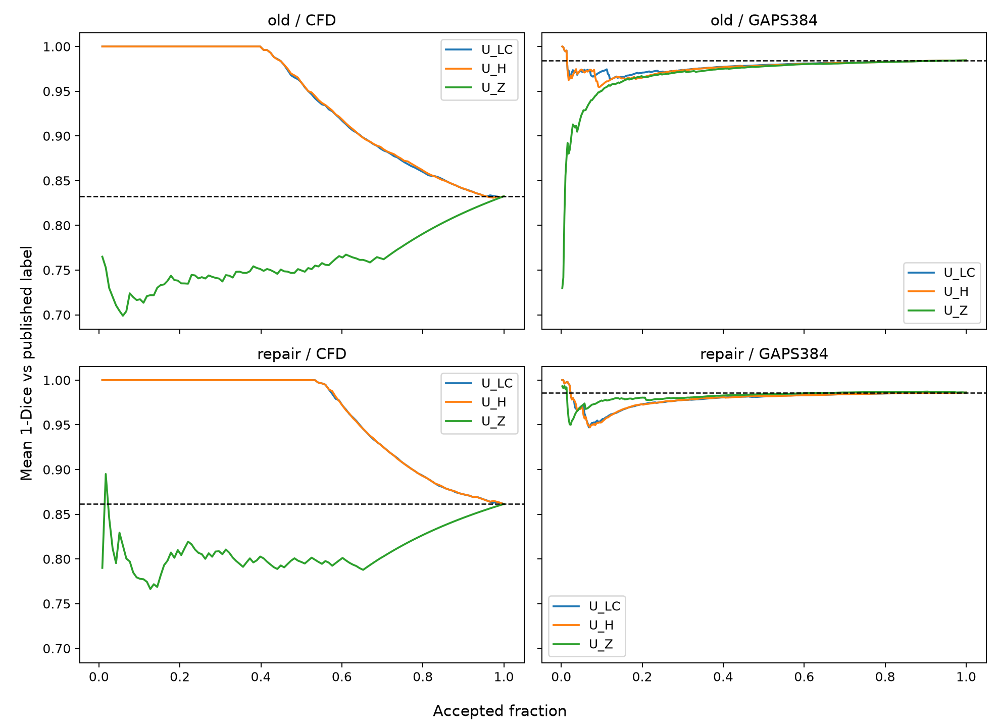

# Result claim audit and final decision — HQ-ROAD-UQ-MATRIX-001-R001

## Purpose and evidence boundary

The no-training 2×2 matrix compares the frozen D1 scratch U-Net and D2 ResNet18/ImageNet repair package on the same two development sources, CFD and GAPS384. It asks whether the apparent D1→D2 change was a cross-source representation gain, a source/label effect, a tolerance-only effect, or a useful uncertainty-ranking signal.

The evidence is limited to agreement with the two datasets' published segmentation labels. It does not establish physical crack truth, crack width, independent-site generalisation, field safety, human-review utility or future crack prediction.

## Execution and audit

`HQ-ROAD-UQ-MATRIX-001-R001` completed once on D-26-09 GPU 0 with no retry, zero training steps and no Road420 access. The task result and process exit code are both 0 and stderr is empty. All 12 remote outputs match their retrieved SHA-256 values. Independent per-row arithmetic exactly reproduces the producer summary and both paired bootstrap intervals; both historical diagonal cells satisfy the `1e-5` comparability limit.

## Complete matrix

| Frozen model / source | Mean Dice | Degenerate nonempty predictions | Mean tolerance F1, 2 px | Mean tolerance F1, 4 px |
|---|---:|---:|---:|---:|
| old / CFD, n=118 | 0.16749 | 47 | 0.38515 | 0.43175 |
| repair / CFD, n=118 | 0.13857 | 62 | 0.32549 | 0.36186 |
| old / GAPS, n=382 nonempty | 0.01554 | 0 | 0.02247 | 0.02849 |
| repair / GAPS, n=382 nonempty | 0.01393 | 0 | 0.02095 | 0.02735 |

The repair package raises mean strict error on both sources. On CFD, `new−old` mean error is `+0.02893`, paired bootstrap 95% interval `[+0.01142, +0.04803]`; exact empty/full predictions rise from 47 to 62. On GAPS, the mean error change is `+0.001607`, interval `[+0.000464, +0.002916]`. The 2/4-pixel mean F1 changes are also negative: `−0.05967/−0.06989` on CFD and `−0.001520/−0.001144` on GAPS. This is neither a cross-source representation gain nor a tolerance-only gain.

GAPS remains substantially harder or less compatible for both packages. The old and repair models predict foreground over mean fractions 0.179 and 0.251 of the image, while published crack masks are thin; both empty-reference images receive false-positive regions under both models. Exact nondegeneracy on GAPS therefore did not indicate useful segmentation.

## Selective acceptance

| Cell | Full risk | Best risk at 25% | Best score | Risk reduction |
|---|---:|---:|---|---:|
| old / CFD | 0.83251 | 0.74070 | `U_Z` | 0.09181 |
| repair / CFD | 0.86143 | 0.80688 | `U_Z` | 0.05455 |
| old / GAPS | 0.98446 | 0.96858 | `U_Z` | 0.01588 |
| repair / GAPS | 0.98607 | 0.97526 | `U_LC` | 0.01081 |

`U_Z` retains a descriptive ordering signal on CFD, but the accepted subset still has mean error 0.741 for the old model and 0.807 for the repair. On GAPS every score leaves accepted risk at least 0.969. The preferred score is not stable across model/source cells, and no cell supplies a useful acceptance queue. Relative risk reduction cannot rescue unusable absolute error.

## Decision-facing visual

**See:** the two CFD panels show a `U_Z` ordering signal but high absolute accepted error; both GAPS panels remain near error 1.0 for all scores. The repair curves do not improve either source.

**Therefore:** the D2 package did not produce cross-source representation gain, and neither 2/4-pixel tolerance nor a more complex uncertainty score turns these outputs into a useful selective-inspection queue.

**Does not show:** which exact capture or annotation convention causes the source mismatch; the matrix diagnoses incompatibility and failed transfer but does not identify physical crack truth.

The fixed failure panels support the same interpretation. On CFD, several repair predictions disappear or cover less of the published crack than the old predictions. On GAPS, both models often segment broad pavement/background regions rather than the thin published traces. These panels are explanatory examples chosen by the frozen paired-delta rule, not an independently sampled prevalence estimate.

## Final decision

- Experiment verdict: `NEGATIVE_FOR_CROSS_SOURCE_REPAIR_AND_SELECTIVE_ACCEPTANCE`.
- Research disposition: `REDIRECT_TO_TARGET_AND_SOURCE_COMPATIBILITY`; stop blind backbone, seed and UQ-score sweeps for the current CRACK500→CFD/GAPS published-mask route.
- Correct the earlier diagonal interpretation: D2's zero exact-degeneracy count was a GAPS cell property, not evidence that the repair fixed D1's CFD collapse. Under the crossed comparison, both packages have zero exact degeneracy on GAPS, and the repair has more degeneracy on CFD.
- Do not promote `U_Z` as a general solution. It remains a CFD-only diagnostic signal with unusable absolute risk and loses to simple confidence in the repair/GAPS cell.
- Do not use tolerant overlap to rescue the result; it is worse for the repair on both sources and remains extremely low on GAPS.
- Road420 remains sealed. This negative development-source matrix supplies no basis to spend the fresh-source budget.

The constructive next route is a prospective target-definition and source-compatibility study using already available public labels: verify what each source encodes (thin centreline, crack region, seam/background inclusion and spatial scale), then select a source pair with the same measurable target before any further segmentation or UQ run. If a compatible target cannot be frozen, stop the published-mask transfer thesis rather than adding models. Any new training, source access or run requires a new exact authorization.
